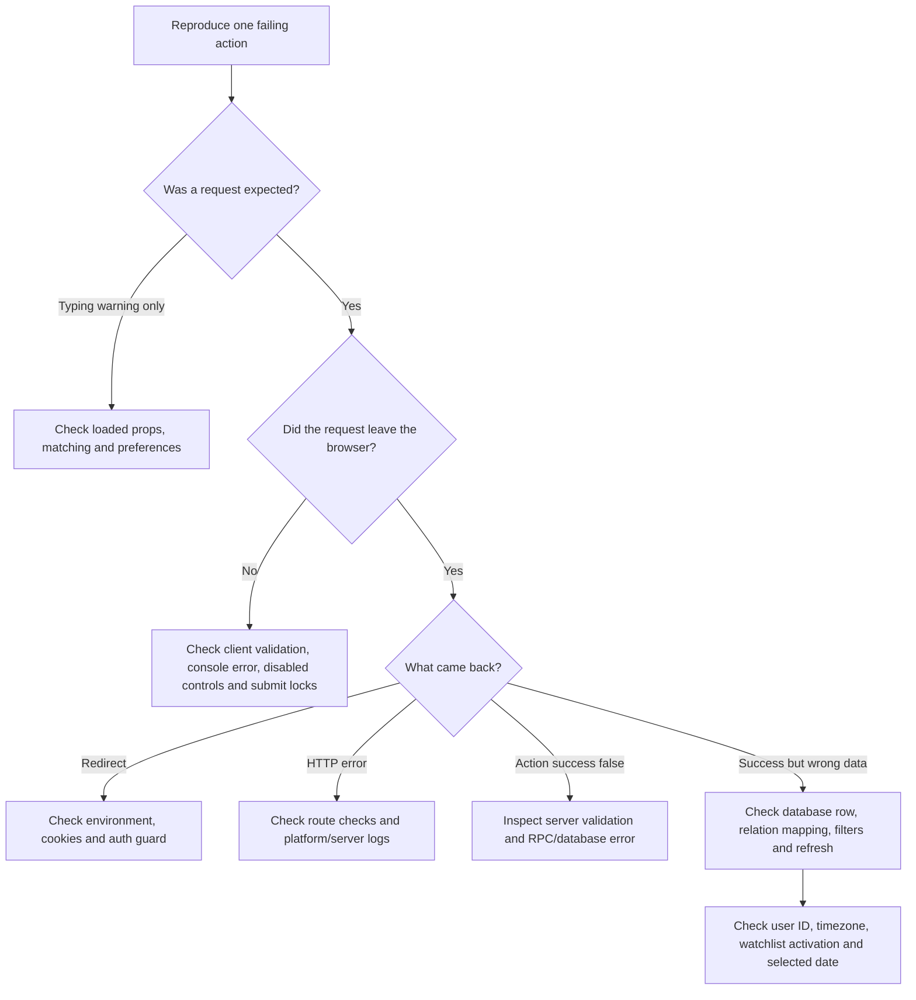

# Food Journal: debugging field guide

Use [system-workflows.md](system-workflows.md) for the full diagrams and data model. This guide tells you where to stop when a specific behavior fails. It describes the current source; it does not inspect your live dashboard or recover deleted records.

## 1. Find which boundary failed first



Before changing code, record: deployment/commit, exact route, action, expected result, actual result, HTTP status/error code, and whether localhost behaves differently. Keep credentials, full cookies, confirmation URLs, signed image URLs and personal reaction notes out of shared logs/screenshots.

Open browser DevTools → Network with Preserve log for redirects, Console for client exceptions, and Application/Storage to inspect whether auth cookies exist. Use server/Next.js logs for actions and route handlers. Use the corresponding Supabase Auth, database or Storage logs for the downstream operation. An action's HTTP transport can succeed while its returned `ActionResult.success` is false; status 200 alone is not proof of a saved row.

## 2. Symptom-to-source map

| Symptom | First files/checks | Expected evidence |
| --- | --- | --- |
| Production shows setup despite configured variables | `lib/supabase/config.ts`, Vercel environment scope and build | Current code reads `...PUBLISHABLE_KEY` or `...ANON`, not the example's `...ANON_KEY`; new build uses intended project |
| Signup does not create a user | `auth-form.tsx`, Supabase Auth/database logs | Auth signup succeeds; `create_profile` trigger can insert profile |
| Signup user exists but no verification email | Auth email/SMTP configuration, email dispatch result | Actual delivery succeeds; UI's check-email text alone does not establish delivery |
| Confirmation returns to localhost | Supabase Site URL, templates and allowed callback URLs | Email points to intended hosted `/auth/callback` |
| Confirmation returns to login with error | `auth/callback/route.ts`, link shape and PKCE context | Code exchange or token-hash verification succeeds once |
| Account already exists when registering on Vercel | Compare selected Supabase project IDs | Same project means same account; use login rather than duplicate signup |
| Login succeeds but journal shows generic error | `queries.ts` profile query and relation queries | Exactly one `profiles` row for verified user ID; migration/RPCs present |
| User loops back to login | `proxy.ts`, `supabase/server.ts`, `requireUser()` | Cookies written for this origin; `getUser()` verifies a current account |
| Deleted/recreated account sees no old entries | Auth UUID and row owner IDs | New signup produces new owner UUID; old data is not automatically reassigned |
| Food Save does nothing | `FoodForm.submit`, schema issues, console | Valid name/time reaches action; no pending/preparing ref lock |
| Food Save reports error | `saveFood`, `save_food_entry` and database logs | Auth/schema/path checks pass; RPC exists and transaction commits |
| Save succeeded but Today appears empty | `eaten_at`, profile timezone, Today date | Entry belongs to selected local calendar date, not just current creation date |
| Editing loses or changes flag association unexpectedly | `save_food_entry`, `trigger_food_id`, renamed entry | Entry editing preserves old trigger link; flag/watchlist edits are separate |
| Warning never appears | `matching.ts`, form props and profile preferences | Active exact/alias match in current user's loaded watchlist |
| Coconut milk unexpectedly warns for milk | Explicit aliases and separately entered ingredients | No substring match; inspect whether user explicitly linked this name or entered Milk separately |
| Warning remains after Undo flag | `undoFlag`, retained reaction and active trigger | Expected separation; archive the watchlist item to stop its warnings |
| Warning shows an old symptom | `trigger-warning.tsx`, report `updated_at` and links | Most recently updated linked report supplies symptoms, not latest meal time |
| Avatar is stronger than latest report | All linked report severities | Any linked severe report selects strong-warning expression |
| Warning dismissal lasts across another name | Warning component key and trigger IDs | Same matched ID set retains local dismissal; disappearing match/remount resets it |
| Archive change from another device is not reflected | Current page load time and refresh | Watchlist props are a snapshot; no realtime subscription |
| Reaction Save fails | `reaction-editor.tsx`, `saveReaction`, `flag_food_entry` | Valid optional fields; atomic food/trigger/report transaction succeeds |
| Repeated flagging creates unexpected history | Entry ID, `trigger_food_id`, alias overlap | One report per entry; fresh flags update last date, editing flagged reports does not |
| Alias/name change fails | `triggerInputSchema`, `save_trigger_food`, uniqueness | No duplicate normalized name/alias; all aliases belong to this user |
| Photo fails before any upload | `images.ts`, browser format and decode | Supported nonempty file, valid signature, canvas encoding succeeds |
| Photo upload reaches API but fails | Photo route status, origin, Auth, bucket and staging table | Authenticated same-origin request stages job then uploads to private bucket |
| Photo saved but no longer displays | `photo_path`, signed URL expiry, `PrivatePhoto` | Path exists; refresh obtains a new one-hour URL; fallback avoids broken image |
| Deleted/replaced photo still in Storage | `media_cleanup_jobs`, storage deletion errors, scheduler | A due job exists and later cleanup can lease/remove it |
| Cron returns 401 | Authorization header and `CRON_SECRET` | Exact secret bearer value, without exposing it in a URL |
| Cron returns 503 | Server service-role configuration | Server-only service key is present; public key is not a substitute |
| Export omits image files | Export route | Expected: JSON contains photo paths, not binaries or signed URLs |
| Delete-account button disabled | Settings page's service-key check | Service-role variable is configured on server deployment |
| Account deletion fails with 403 | Request origin, password, verified current user | Same-origin request and correct fresh password for same user |
| Account deletion failed after photos disappeared | Account route's stage-specific message | Cross-service partial failure; Auth deletion may have failed after Storage cleanup |
| Public page works but private requests fail | Session project/origin, RLS and migration | Auth token and database target refer to same project/user |
| Browser test skipped | `tests/e2e/journal.spec.ts` environment gate | Dedicated URL/key/user credentials set; skip is not a passed persistence check |

## 3. Authentication repair checklist

1. Compare localhost and Vercel project URLs without sharing keys. Determine whether they intentionally use the same Supabase project.
2. Inspect `src/lib/supabase/config.ts` for exact variable names. In the current source the anon fallback is `NEXT_PUBLIC_SUPABASE_ANON`. Existing setup text/examples use `_ANON_KEY`; this discrepancy can make a configured-looking installation fail. Align intentionally, then rebuild/redeploy.
3. Confirm which Vercel environment the variables belong to: Production and Preview are separate scopes.
4. Check Supabase Site URL and allowed callback destinations for the actual domain. A custom email template using `SiteURL` and the form's `emailRedirectTo` are two inputs; changing one may not change the other.
5. Check whether the account is confirmed and still exists. An old browser cookie can outlive manually deleted user data; sign out/clear that site's session and log in again.
6. If a link uses `code`, reproduce in the browser/origin that initiated the PKCE flow. If it uses `token_hash`, inspect template structure rather than posting that secret link in an issue.
7. If `auth.users` exists but `profiles` does not, investigate the migration/trigger or prior manual deletion. Do not delete/recreate accounts merely to bypass a profile error; it can erase owner-linked data. The app does not repair missing profiles on login.
8. Retry with a new confirmation/recovery email when the earlier link has expired or been consumed. The current login UI has no dedicated resend-confirmation button, so do not search for an implemented one.

## 4. Trace a saved food with read-only SQL

Run only in your own Supabase SQL Editor. Replace the example UUID with the selected test user's ID. These queries do not change data, but an administrative SQL session may bypass RLS: its results do **not** prove normal user isolation. Prefer a disposable test account and inspect identifiers/flags/timestamps before private content.

```sql
-- Does the application profile exist for this auth user?
select id, timezone, warnings_enabled, avatar_enabled
from public.profiles
where id = '11111111-1111-4111-8111-111111111111';

-- Did an entry commit? Are eaten and recorded times distinct?
select id, user_id, eaten_at, created_at, updated_at,
       is_flagged, trigger_food_id, photo_path
from public.food_entries
where user_id = '11111111-1111-4111-8111-111111111111'
order by created_at desc
limit 20;

-- Is the linked trigger active? Is a report attached?
select e.id as entry_id, e.is_flagged, e.trigger_food_id,
       t.is_active, t.first_flagged_at, t.last_flagged_at,
       r.id as reaction_id, r.created_at as report_created_at,
       r.updated_at as report_updated_at
from public.food_entries e
left join public.trigger_foods t
  on t.id = e.trigger_food_id and t.user_id = e.user_id
left join public.reaction_reports r
  on r.food_entry_id = e.id and r.user_id = e.user_id
where e.user_id = '11111111-1111-4111-8111-111111111111'
order by e.created_at desc
limit 20;

-- Are image removals staged, due, or already claimed?
select id, path, due_at, cleanup_started, created_at
from public.media_cleanup_jobs
where user_id = '11111111-1111-4111-8111-111111111111'
order by due_at;

-- Has the migration installed the expected owner policies?
select schemaname, tablename, policyname, roles, cmd
from pg_policies
where schemaname in ('public', 'storage')
order by schemaname, tablename, policyname;
```

For a warning that does not match, additionally compare the trigger's `display_name`, its alias rows and the browser's `normalizeFoodName()` output. Store/search names may differ from the actual entered candidate because punctuation is normalized and each component is checked independently.

## 5. HTTP and action error meanings

| Boundary/result | Likely branch |
| --- | --- |
| Protected-page redirect to `/setup` | Runtime sees no configured URL/public-key pair |
| Protected-page redirect to `/login` | `getUser()` cannot verify the current account |
| `/login?error=confirmation` | Callback did not establish a verified session |
| Photo/account 503 | Missing configuration; account 503 can specifically mean absent service-role key |
| Photo/account 403 | Origin mismatch, foreign photo path, or account password verification failure depending on endpoint |
| Photo/account/export 401 | No verified signed-in user, after earlier endpoint checks pass |
| Photo 400 | Bad multipart file, unsupported/invalid bytes, empty/oversized image, or malformed DELETE path |
| Photo DELETE 409 | Referenced photo, no longer-staged upload, or lease/adoption race prevented deletion |
| Photo 500 | Staging, upload or Storage cleanup failed; inspect which step produced the response |
| Account 500 | Storage list/remove or admin Auth deletion failed; message identifies partial stage |
| Export 500 | `getJournal()`/serialization path could not complete |
| Cron 401 | Missing/mismatched bearer secret; checked before service-role setup |
| Action `{success:false,error:...}` | Expected validation/database failure; frontend should keep draft and show error |
| Unexpected exception or platform 413/5xx | Can occur outside these branch tables; inspect Next/Vercel logs and body limits |

The order of checks matters. For example, an unconfigured photo route returns 503 before checking origin, and configured photo requests with no Origin header fail the origin check before user verification. A raw API client is not automatically equivalent to the browser.

## 6. Targeted tests for each subsystem

Run commands from the project root. On Windows use `npm.cmd` if PowerShell blocks `npm.ps1`. All commands below are local except tests you intentionally configure to use a real Supabase project.

| Change/failure | Focused command |
| --- | --- |
| Exact names, aliases and archiving | `npm test -- src/lib/matching.test.ts` |
| Timezones, midnight and DST | `npm test -- src/lib/time.test.ts` |
| Form/schema validation | `npm test -- src/lib/schemas.test.ts` |
| Image validation and failed display | `npm test -- src/lib/images.test.ts src/components/private-photo.test.tsx` |
| Warning-before-save and nonblocking continuation | `npm test -- src/components/food-form.test.tsx src/components/trigger-warning.test.tsx` |
| Reaction report and pending/discard behavior | `npm test -- src/components/reaction-editor.test.tsx` |
| History date/filter behavior | `npm test -- src/components/history-view.test.tsx` |
| Preferences/account confirmation UI | `npm test -- src/components/settings-form.test.tsx` |
| Auth guards and query shape | `npm test -- src/lib/server/queries.test.ts` |
| Trusted mutation inputs | `npm test -- src/lib/server/actions.test.ts` |
| Photo endpoint/cleanup lease ordering | `npm test -- src/app/api/photos/route.test.ts` |
| Confirmation/recovery callback | `npm test -- src/app/auth/callback/route.test.ts` |
| Overall local checks | `npm run check` |
| Built-app browser checks | `npm run build` then `npm run test:e2e` |

Real-account E2E requires dedicated confirmed test users and the matching migrated project. It adds/deletes its exact generated records. Do not point these tests at valuable personal accounts or assume setting `E2E_BASE_URL` alone aligns the test client's Supabase project with the remote app.

Database isolation: run `supabase/tests/rls.sql` against a disposable local Supabase database as documented in [testing.md](testing.md). It checks database permissions/transactions separately from mocked React tests. A green component test does not establish that production RLS or SMTP is configured correctly.

## 7. What to preserve when fixing a bug

- Preserve eaten time separately from database creation time.
- Keep flag, report and watchlist activity independent unless changing that contract deliberately.
- Keep warnings advisory; dismissing/continuing must not prevent saving.
- Preserve user scoping on server queries and in database/Storage policies.
- Use the Storage API for object deletion; do not remove Storage metadata using SQL.
- Never add service-role credentials to browser code or public environment variables.
- Keep cleanup intent durable across failures and use the lease before staged-object deletion.
- Test failure and retry, not only the happy path. A mutation may commit before a later network response fails; reconcile database state before manually resubmitting or deleting records.

For a new bug, add a short reproduction and a focused regression test where it can catch the actual boundary. Then update the corresponding workflow if the intended behavior changed.
