# Food Journal: system workflows

This guide describes the current checked-out implementation. It maps a click to the component, server boundary, database operation and resulting screen so you can follow the same path when debugging. It is a source-code map, not a claim that the live Vercel/Supabase configuration has been inspected.

Start with sections 1–4. Then follow one feature end to end. Use [the debugging guide](debugging.md) when something breaks. Mermaid blocks render as diagrams on GitHub; their contents can also be pasted into Mermaid Live Editor. Source links below are relative to this repository.

## Contents

1. [Architecture and vocabulary](#1-architecture-and-vocabulary)
2. [Route and file map](#2-route-and-file-map)
3. [Opening a protected page](#3-opening-a-protected-page)
4. [Signup, confirmation, login and recovery](#4-signup-confirmation-login-and-recovery)
5. [Database relationships and ownership](#5-database-relationships-and-ownership)
6. [Creating and editing food](#6-creating-and-editing-food)
7. [Photo lifecycle](#7-photo-lifecycle)
8. [Flagging and editing reactions](#8-flagging-and-editing-reactions)
9. [Matching, warnings and avatar states](#9-matching-warnings-and-avatar-states)
10. [Watchlist editing and archiving](#10-watchlist-editing-and-archiving)
11. [Today, history and timezones](#11-today-history-and-timezones)
12. [Deleting a food entry](#12-deleting-a-food-entry)
13. [Settings, export, sign-out and account deletion](#13-settings-export-sign-out-and-account-deletion)
14. [Validation, errors, concurrency and refresh](#14-validation-errors-concurrency-and-refresh)
15. [Deployment and environment boundaries](#15-deployment-and-environment-boundaries)
16. [Worked example and learning order](#16-worked-example-and-learning-order)

## 1. Architecture and vocabulary

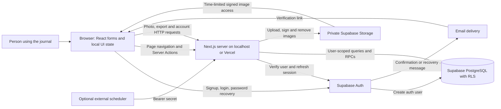

| Term | Meaning here |
| --- | --- |
| Client component | Interactive React code in the browser, such as `FoodForm` or `SettingsForm` |
| Server component | Route/layout code that loads authenticated data before rendering |
| Server Action | A function in `lib/server/actions.ts` called from the UI through Next.js; it is not a REST URL you chose manually |
| Route handler | An explicit HTTP endpoint such as `POST /api/photos` |
| RPC | A PostgreSQL function invoked through `client.rpc(...)`; multiple related SQL writes share one transaction |
| RLS | PostgreSQL Row Level Security: the database checks which rows the current user may access |
| Profile | App preferences in `public.profiles`, separate from credentials/confirmation in `auth.users` |
| Signed URL | Temporary permission to retrieve a private image; it is not the stored photo path |
| Active watchlist | Foods whose `trigger_foods.is_active` is true; the source of warning matches |

There is no external diagnostic AI, nutrition engine, background queue worker or automatic dietary recommendation. Matching runs locally over the authenticated user's loaded watchlist. Ordinary food/reaction writes go through the Next.js server using the user's session. The admin client is reserved for account deletion and scheduled cleanup.

## 2. Route and file map

The `(journal)` directory is a route group, so its name does not appear in browser URLs.

| Browser route | Route source under `src/app` | Main responsibility |
| --- | --- | --- |
| `/` | `(journal)/page.tsx` | `getJournal()` → `TodayView`; `?saved=1` selects the happy message |
| `/add` | `(journal)/add/page.tsx` | `getJournal()` → `FoodForm` |
| `/add?edit=ID` | Same Add route | Find the owned entry; prefill `FoodForm`; missing ID produces not-found |
| `/entry/ID` | `(journal)/entry/[id]/page.tsx` | `EntryDetail`, reaction dialog, edit/delete/undo actions |
| `/triggers` | `(journal)/triggers/page.tsx` | `TriggersView`: active/archive tabs, search and sort |
| `/triggers/ID` | `(journal)/triggers/[id]/page.tsx` | `TriggerDetail`: linked entries, aliases, notes, archive/reactivate |
| `/history` | `(journal)/history/page.tsx` | `HistoryView`: selected date, name search and flag filter |
| `/settings` | `(journal)/settings/page.tsx` | `SettingsForm`: profile/preferences/export/account |
| `/login` | `login/page.tsx` | `AuthForm`: login/signup/reset-email modes |
| `/auth/callback` | `auth/callback/route.ts` | Verify code/token and redirect with a session |
| `/reset-password` | `reset-password/page.tsx` | Verify a user, then render password update form |
| `/setup` | `setup/page.tsx` | Explain missing connection; configured projects redirect to login |

| HTTP endpoint | Request | Purpose |
| --- | --- | --- |
| `/api/photos` | POST, multipart `file` | Validate and stage a private image upload; return `{path}` |
| `/api/photos` | DELETE, JSON `{path}` | Remove an unadopted staged image safely |
| `/api/export` | GET | Download the current user's journal JSON |
| `/api/account` | DELETE, JSON `{password, confirmation: "DELETE"}` | Reauthenticate, remove photos and delete the account |
| `/api/cleanup` | GET with secret bearer header | Process due cleanup jobs using the admin client |

Shared presentation: [AppShell](../src/components/app-shell.tsx), [Avatar](../src/components/avatar.tsx), [global tokens](../src/app/globals.css), [journal styles](../src/app/journal.css), [brand/config](../src/lib/config.ts).

## 3. Opening a protected page

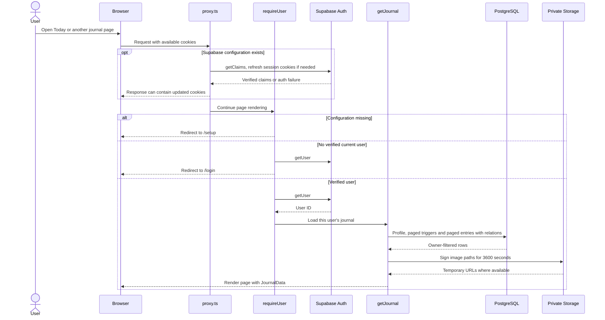

Read [proxy.ts](../src/proxy.ts) → [server client](../src/lib/supabase/server.ts) → [queries.ts](../src/lib/server/queries.ts) → [protected layout](<../src/app/(journal)/layout.tsx>).

- The proxy attempts session verification/refresh. It does **not** decide all authorization or redirect every signed-out request itself. `requireUser()` protects the journal and actions using `getUser()`.
- The protected layout also reads the display name for the sidebar. The page calls `getJournal()` for its data.
- `getJournal()` requires one profile row, pages through triggers and food entries in batches of 500, and requests signed image URLs in batches of 100.
- Entry relations become `components` plus one `reaction` object or null. The code accepts both object and array relation shapes from the database API.
- React `cache()` deduplicates these functions within server rendering; it is not a permanent global watchlist shared between accounts.
- All journal data is loaded into the view today. Date/search controls filter it in the browser. This is important when investigating large-journal performance.

**Useful breakpoint:** `profileResult.error` and each query's `error` in `getJournal()`. A valid login with a manually deleted profile still fails here: profile creation happens at signup, not at every login.

## 4. Signup, confirmation, login and recovery

### Signup and profile creation

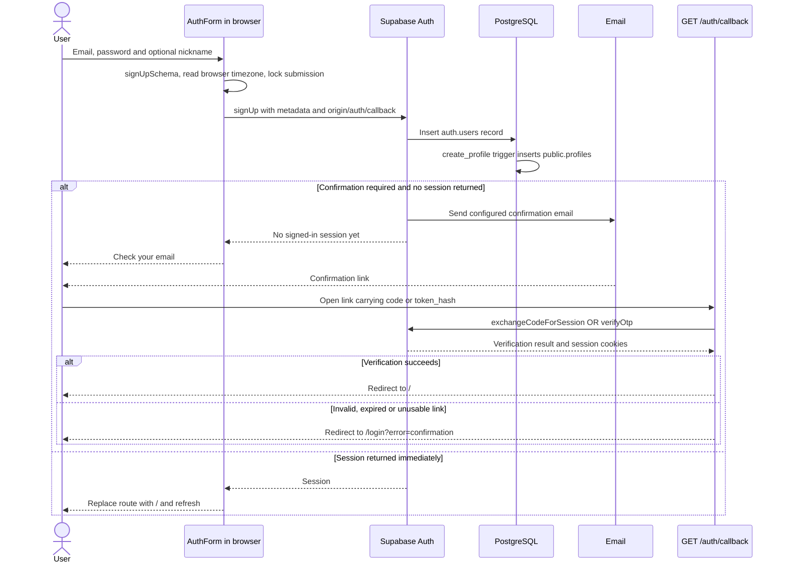

Source: [AuthForm](../src/components/auth-form.tsx), [callback handler](../src/app/auth/callback/route.ts), [profile trigger in migration](../supabase/migrations/202611170001_food_journal.sql), [AuthNotice](../src/components/auth-notice.tsx).

The SQL trigger is `create_profile` on `auth.users`, executing `create_profile_for_user()`. It copies the nickname and validates the metadata timezone against PostgreSQL timezone names, falling back to UTC. The profile normally exists **before email confirmation**. A failing trigger can prevent signup itself.

The callback supports two mechanisms:

| Callback input | Method | What to check when broken |
| --- | --- | --- |
| `?code=...` | `exchangeCodeForSession(code)` | PKCE verifier from the originating browser/session; switching localhost/Vercel or browsers can lose this context |
| `?token_hash=...&type=signup` | `verifyOtp(...)` | Confirmation template must send the token hash and an accepted type |
| `?token_hash=...&type=email` | `verifyOtp(...)` | Accepted by the handler; the UI does not implement a separate magic-link login screen |
| `?token_hash=...&type=recovery` | `verifyOtp(...)` | Establishes the recovery session and redirects to the password form |

`next=/reset-password` or `type=recovery` selects `/reset-password`; all other destinations become `/`. Arbitrary external redirect destinations are not honored. A `code` takes precedence over token-hash handling when both are supplied.

**Your localhost/Vercel situation:** accounts are stored in the selected Supabase project, not separately inside each app deployment. If the project is shared, use the existing login in both environments. Cookies are origin-specific, so signing in locally does not automatically sign you in on the Vercel domain. Deleting/recreating a user creates a new UUID; it does not restore the old journal ownership.

### Login, session persistence and sign-out

`AuthForm` validates email/password → browser client `signInWithPassword()` → session cookies → `router.replace("/")` and `router.refresh()` → server `requireUser()` verifies the account → journal loads. Authentication failures are displayed in the form. Signup does not use a separate application-owned `/api/signup` endpoint.

The browser client is [client.ts](../src/lib/supabase/client.ts). Server rendering/actions use the cookie-backed [server.ts](../src/lib/supabase/server.ts). The latter catches cookie-write attempts in read-only Server Components because the proxy performs refresh writes. The [admin client](../src/lib/supabase/admin.ts) is server-only and does not persist a user session.

Sign-out uses the `signOut` Server Action with `{scope: "local"}`. It checks errors and redirects to `/login` only after success. This signs out the current device/session, not all other devices.

### Password recovery

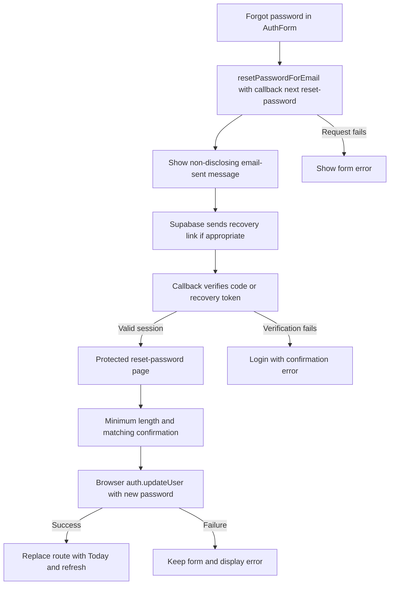

Read [ResetPasswordForm](../src/components/reset-password-form.tsx). The page requires a signed-in user; the password update is enforced through Supabase Auth rather than a journal-table write. Email dispatch success does not establish delivery to the inbox.

## 5. Database relationships and ownership

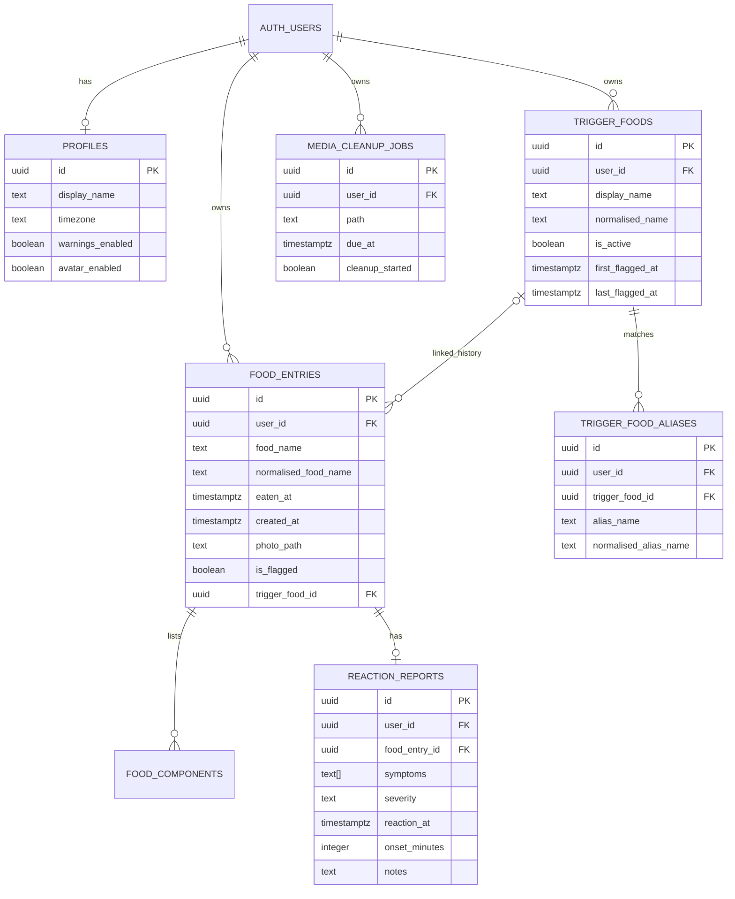

The diagram highlights behavior-driving fields; [types.ts](../src/lib/types.ts) and [the migration](../supabase/migrations/202611170001_food_journal.sql) contain the full fields, timestamps, indexes and constraints. Food components and reaction/alias rows also belong to their auth user through `user_id`.

Database invariants:

- All seven public user-owned tables have RLS. A normal authenticated user can only access their own rows; anonymous roles have no table access.
- Composite foreign keys include the owner ID, preventing an owned reaction/component/alias from linking to another user's entry/trigger.
- One report per entry is enforced with a unique `food_entry_id`.
- Canonical normalized trigger names are unique per user. Normalized aliases are also unique per user across alias rows.
- The photo path is unique per food entry and must start with its user's UUID.
- `stamp_row()` generates `created_at` for profile/entry/report inserts and preserves it on updates. It updates `updated_at`; names are normalized in database triggers.
- `first_flagged_at` survives trigger updates. Fresh flagging updates `last_flagged_at`; editing an already flagged report does not create a new flag event.
- Auth-user deletion cascades into user-owned database rows. Deleting a food cascades into its components/report, while its watchlist row remains.

RLS checks ownership, not every business rule. SQL constraints/triggers/RPCs and server Zod validation each have separate responsibilities. The service-role client bypasses normal owner RLS and is kept out of the browser.

## 6. Creating and editing food

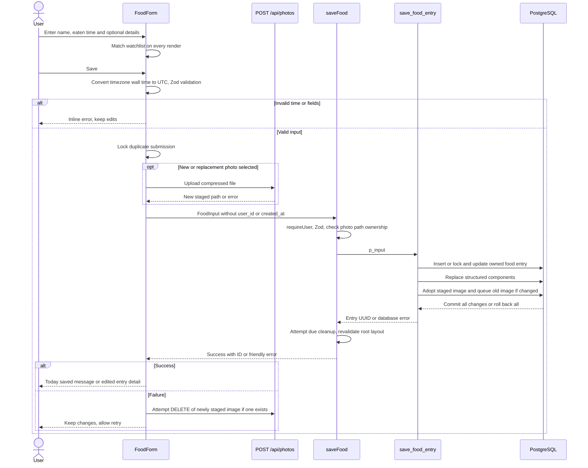

Sources: [Add route](<../src/app/(journal)/add/page.tsx>) → [FoodForm](../src/components/food-form.tsx) → [schemas](../src/lib/schemas.ts) → [actions](../src/lib/server/actions.ts) → `save_food_entry` in the migration.

Create and edit use the same form/action. An `id` selects the update branch; the SQL RPC locks that owned entry with `FOR UPDATE`. Otherwise it generates a UUID and inserts. Missing/foreign edit IDs do not produce an editable record. The form strips blank optional component rows and keeps each named component structured as `food` or `ingredient`; it does not split a comma-separated sentence into inferred foods.

Normal food saving does **not** flag the entry, create a reaction, or add a trigger. Logging a known trigger again also does not automatically mark the new entry red. Those are explicit user choices.

Editing a flagged entry's name does not rename its linked trigger or automatically reassociate it. `save_food_entry` does not change `trigger_food_id`; edit watchlist details separately when correcting that relationship's meaning.

## 7. Photo lifecycle

### Selection is local; upload happens on Save

`compressImage()` checks the input MIME/size and signature, decodes the actual image, draws to a canvas with maximum dimension 1600px and encodes JPEG at quality 0.84. Canvas re-encoding strips original file metadata. Transparent inputs receive a white background. The form creates a preview, but no durable upload occurs until submission. JPEG, PNG and WebP inputs up to 10 MiB are supported; HEIC must be converted.

The POST handler independently checks same-origin, current user, size, declared type and magic bytes. It creates `<user UUID>/<random UUID>.<extension>` and inserts a cleanup row **before** uploading to the private `food-photos` bucket. The row is due one hour later. Upload failures therefore do not leave an untracked attempt.

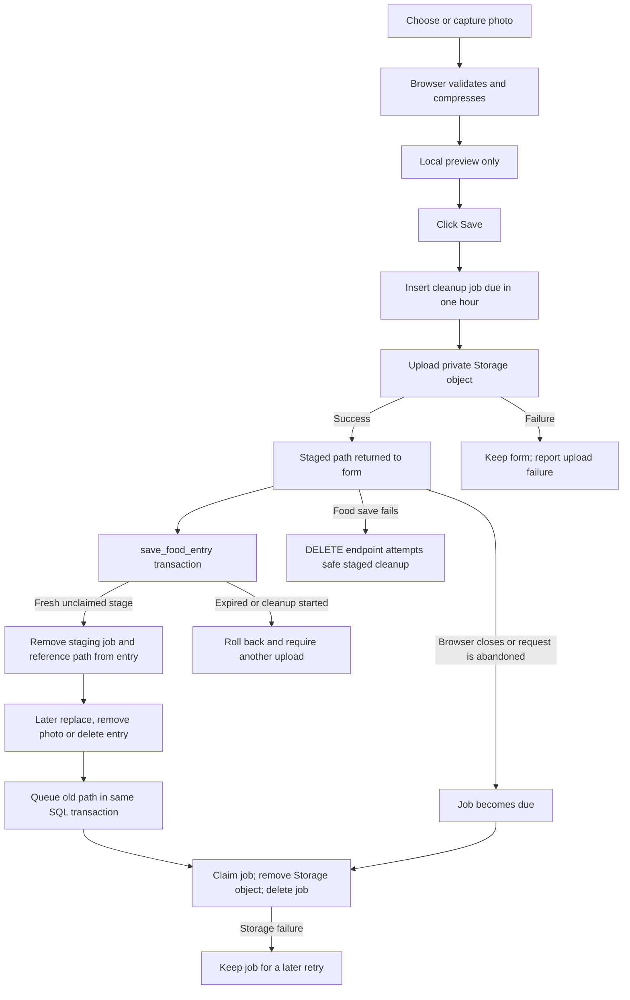

### Why cleanup is separate

PostgreSQL and Storage do not share one transaction. A food save must not discard the intent to delete an old photo just because Storage is temporarily unavailable. Cleanup jobs preserve that intent.

- `drainMediaCleanup(userId)` runs after successful food save/delete and handles up to 100 due jobs for that user.
- `GET /api/cleanup` handles up to 500 due jobs with the server admin client. It needs both the correct `CRON_SECRET` bearer header and a service-role key. A scheduler must actually call it; defining the endpoint alone does not schedule anything.
- `claim_media_cleanup` locks the job, checks for a live food reference, and sets `cleanup_started=true` before returning a deletable path. Saving a new photo takes the corresponding stage lock and rejects expired/claimed stages. This prevents adoption racing with deletion.
- `DELETE /api/photos` is for staged-upload recovery, not for removing a saved entry's current image. It checks references, expires an existing owned stage, claims it, then removes the leased path. Saved image removal belongs to `saveFood`.
- A failed storage removal retains the job for later retry. A referenced file causes the cleanup claim to discard the stale job instead of deleting the image.

### Reading photos

`getJournal()` signs saved paths for 3600 seconds. [PrivatePhoto](../src/components/private-photo.tsx) renders the signed URL and replaces failed images with an accessible fallback. Refreshing the page generates fresh URLs. There is no automatic one-hour renewal timer. The database stores the durable path, not the temporary URL; exports omit signed URLs and image bytes.

Read [images.ts](../src/lib/images.ts), [photo route](../src/app/api/photos/route.ts), [media helper](../src/lib/server/media.ts), [cleanup endpoint](../src/app/api/cleanup/route.ts).

## 8. Flagging and editing reactions

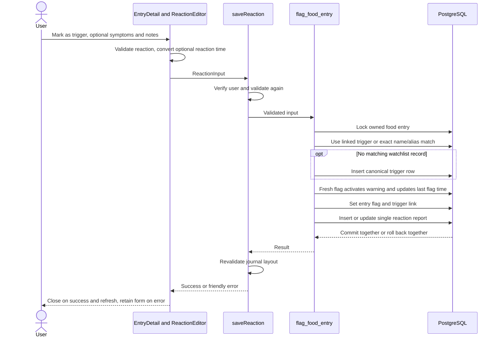

Read [EntryDetail](../src/components/entry-detail.tsx), [ReactionEditor](../src/components/reaction-editor.tsx), `saveReaction` and `flag_food_entry`.

All details are optional: an empty symptom array with null severity/time is valid. A saved flag can therefore have an empty report. Editing the report uses an upsert on `food_entry_id`, preserving its database creation timestamp and identity.

Trigger selection first uses `entry.trigger_food_id`. If absent, it searches the user's canonical normalized names and explicitly configured aliases. If more than one canonical/alias candidate matches, SQL selects the first by trigger UUID; browser matching can display multiple matches. Investigate name/alias overlap if the resulting linked history surprises you.

Freshly flagging an unflagged entry activates/reactivates its warning. Editing an **already flagged** report preserves an archived watchlist's active state and does not bump its last flag timestamp. Historical notes may still influence warnings after an entry's flag is undone because the report and trigger link remain.

The dialog blocks close actions while saving, prevents duplicate submits and confirms discard of changed notes. A failed action keeps edits for retry.

### Three independent kinds of state

| User action | Historical `is_flagged` | Reaction report | Watchlist `is_active` |
| --- | --- | --- | --- |
| Save ordinary food | False on new entry | No report | Unchanged |
| Mark unflagged food as trigger | True | Insert/update, even if empty | Active |
| Edit already flagged report | True | Update existing report | Preserve active/archive choice |
| Undo entry flag | False | Preserve | Preserve |
| Remove reaction details | Preserve | Delete | Preserve |
| Archive warning | Preserve | Preserve | False |
| Reactivate warning | Preserve | Preserve | True |
| Delete entry | Entry deleted | Cascade delete | Preserve trigger row |

This separation explains why undoing a red badge does not stop future warnings automatically.

## 9. Matching, warnings and avatar states

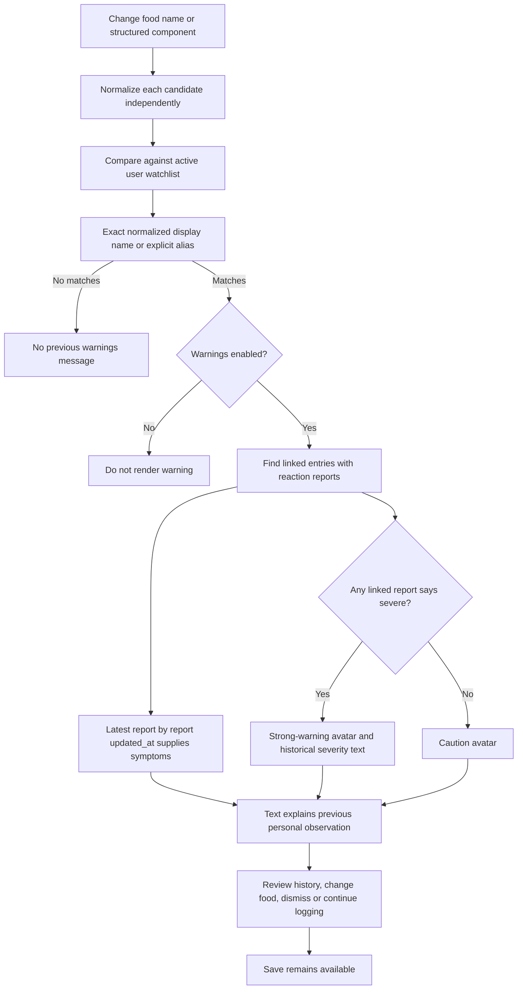

Source: [matching.ts](../src/lib/matching.ts) → [FoodForm](../src/components/food-form.tsx) → [TriggerWarning](../src/components/trigger-warning.tsx) → [Avatar](../src/components/avatar.tsx).

Normalization is `NFKC` Unicode normalization → lowercase → replace non-letter/non-number runs with spaces → trim/collapse spaces. `Milk!` and ` milk ` match `Milk`. `Coconut milk` does not match `Milk` unless explicitly added as an alias or a separate `Milk` ingredient is entered. No network request is made for each keystroke. The form uses the watchlist loaded when the page rendered, so another device's change needs a page refresh/new load to appear.

The browser derives matching names from display names and aliases, rather than trusting stored normalized columns. PostgreSQL normalizes independently for uniqueness/linking; uncommon Unicode/collation differences are a possible debugging boundary.

The latest symptoms come from the most recently **updated report**, not necessarily the most recent eaten time or symptom onset. Strong expression uses **any** linked severe report. The warning code does not require those linked entries to remain red-flagged. Neither expression is a medical risk calculation.

Dismissal is local UI state. It does not archive the warning or change the database. `FoodForm` keys the warning by matched trigger IDs, resetting dismissal when that set changes. Changing to another alias of the same matched trigger can keep dismissal until the match disappears, the set changes or the form remounts.

| Avatar state | Actual trigger in this implementation |
| --- | --- |
| Neutral | Default Today, login/setup, optional Add Food companion |
| Happy | Today rendered with `?saved=1` after successful creation |
| Caution | Active exact/alias warning with no linked severe report |
| Strong warning | Matching trigger has a linked report the user described as severe |
| Review | Trigger-list overview |

Disabling the avatar hides the illustration, not enabled warning text. Disabling previous-food warnings hides warning UI without deleting the watchlist. The query-string happy message is presentation state, not independent proof of a successful database write.

## 10. Watchlist editing and archiving

`TriggersView` receives `JournalData`, filters by active/archive tab, searches display names and aliases, and sorts by last-flagged date or name. These controls do not mutate rows. Its flagged count counts linked entries with `is_flagged=true`; latest symptoms may come from any linked report. First/last flag dates survive removal of individual entries.

`TriggerDetail` shows all entries whose `trigger_food_id` matches, sorted by eaten time. This can include an entry whose flag was undone. Linked reports show symptoms, user-described severity, onset and notes.

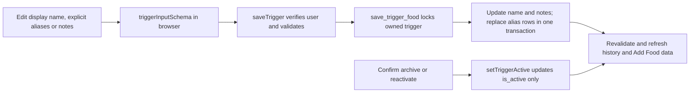

Renaming changes what canonical name will match later. Add the previous name as an explicit alias if you want it to continue matching. Linked historical entry names are not rewritten. Alias validation rejects duplicate normalized aliases within the submitted list and an alias equal to its own display name; database uniqueness also rejects an alias already owned by another alias row for that user.

Archiving never deletes food history or reaction reports. The normal UI offers archive/reactivate, not physical deletion of the watchlist row.

## 11. Today, history and timezones

Read [time.ts](../src/lib/time.ts), [TodayView](../src/components/today-view.tsx), [HistoryView](../src/components/history-view.tsx).

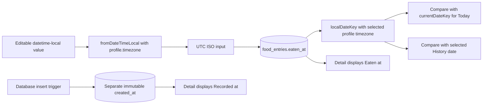

Example: you ate at 12:30 and logged it at 16:15. Both instants are stored independently. Changing `eaten_at` later does not change `created_at`. History groups by the eaten instant's calendar date in the profile timezone, not the record creation date or the server's timezone.

The form defaults its wall time from the profile timezone. Signup initially sets that timezone from the browser. Changing the profile timezone changes display/grouping, not stored UTC instants. The History search operates **within the selected date**, not across every date. All/flagged/unflagged filtering is then applied and entries sort chronologically. Meal categories are explicit selections, never inferred from clock time.

DST conversion rejects nonexistent local times by round-tripping them. During an overlapping repeated hour, it selects the earlier equivalent instant among its checked offset candidates. The datetime input has minute precision; editing can discard seconds from an original stored eaten timestamp. There is no interval ticking Today or History over at midnight while a page remains idle; refresh the view if the day changes in an open tab.

## 12. Deleting a food entry

User opens `EntryDetail` → confirmation dialog → `deleteFood(id)` → verified user and UUID → `delete_food_entry` locks owned entry → queues its current photo if present → deletes entry → database cascades components/report → attempts due photo cleanup → revalidates → browser goes to History.

The watchlist row, aliases and first/last flag dates are preserved. A watchlist can therefore have zero remaining linked entries and still warn while active. A photo cleanup failure can leave a queued object temporarily; it should not resurrect a deleted entry. Database errors keep the confirmation open with recovery text.

## 13. Settings, export, sign-out and account deletion

### Preferences

`SettingsForm` → `profileInputSchema` → `saveProfile` → `requireUser()` → validate again → update owned `profiles` row → revalidate → `router.refresh()`. It stores nickname, IANA timezone, warning display and avatar display. The sidebar reads the profile, so updated names can be reflected without editing Auth metadata. The Auth email is displayed as account identity; this settings UI does not implement an email-change workflow.

### Export

Download link → `GET /api/export` → verify user → `getJournal()` → serialize profile, entries and triggers with a version/export timestamp → remove `photo_url` fields → JSON attachment. Components and reactions are nested within entries; aliases are nested in triggers. The export includes durable photo paths but not image binaries, passwords, auth tokens, signed URLs or cleanup jobs. The current implementation still loads/signs through `getJournal()` before discarding the URLs from the export.

### Account deletion

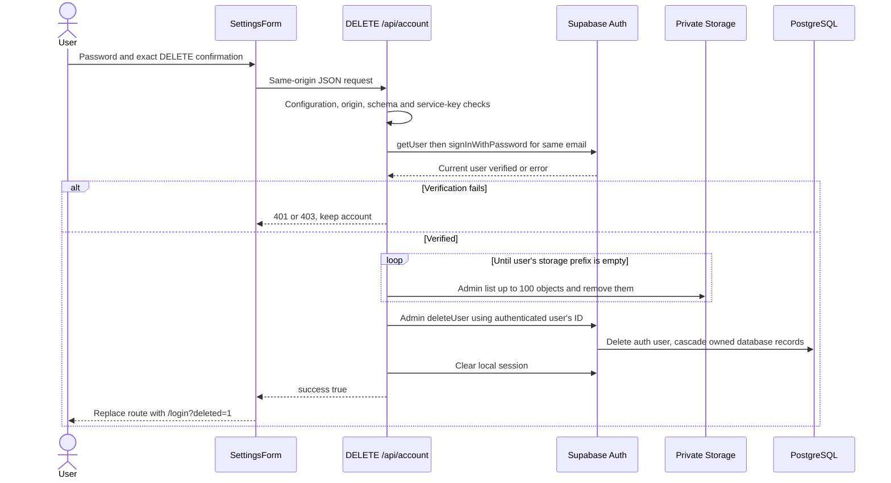

Read [SettingsForm](../src/components/settings-form.tsx) and [account endpoint](../src/app/api/account/route.ts). The server never accepts a browser-supplied target user ID. The Settings route enables the destructive control only when a service-role environment value exists; the endpoint checks it again.

Account deletion is **not atomic across Storage and Auth**. If photo removal fails, the account remains and the API reports failure. If Auth deletion fails after photo cleanup, some/all images may already be gone; the message tells the user to retry/contact the owner. Do not describe that case as a fully rolled-back deletion.

Deleting an Auth user manually in the dashboard bypasses this app's photo-cleanup sequence. The schema cascades journal rows, but database cascades are not Storage API deletion. Investigate old private objects separately when doing manual administrative deletion.

## 14. Validation, errors, concurrency and refresh

| Layer | Responsibility | Where to inspect |
| --- | --- | --- |
| Browser form | Fast field feedback, local state, disabled controls, save lock | Feature component and `schemas.ts` |
| Server Action | Verify identity, validate again, choose RPC/update, hide private DB error details | `lib/server/actions.ts` |
| Route handler | Method-specific JSON/multipart, origin/auth checks and HTTP errors | `app/api/*/route.ts` |
| SQL | Owner-aware relationships, uniqueness, timestamp rules, transactions and row locks | Migration and Supabase database logs |
| RLS/Storage policy | Enforce access even when a caller bypasses the React UI | Migration policies and authenticated isolation tests |

The forms use local React state and synchronous ref locks rather than a global state store. Dirty form changes prompt on reload/ordinary same-origin link navigation. Download/new-tab/modifier clicks are excluded; browser Back/Forward is not comprehensively intercepted. A failed save normally preserves the draft. The reaction dialog additionally guards close while pending and asks before discarding edits.

Successful actions call `revalidatePath("/", "layout")`; form/detail clients call `router.refresh()` and sometimes push/replace routes. This is not realtime synchronization or a WebSocket subscription. No success is shown before the action returns success. SQL locks serialize related operations, but the app does not implement a version/conflict-resolution UI: two devices editing the same entry can overwrite earlier changes with the later successful save.

`(journal)/loading.tsx` covers page loading; `(journal)/error.tsx` presents a generic error and retry; missing entry/trigger IDs use `notFound()`. Expected action errors are returned as `ActionResult`, while auth guards redirect and unexpected exceptions can reach a boundary. Friendly UI text deliberately does not expose raw SQL errors. Server logs may therefore be needed to distinguish a missing function from a constraint violation. Do not log complete reaction payloads to obtain that distinction.

## 15. Deployment and environment boundaries

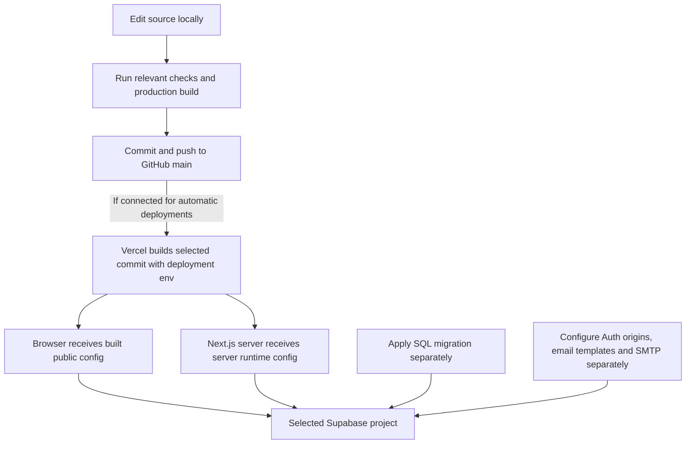

Pushing application code does not apply Supabase SQL or update Supabase Auth settings. A Vercel Preview environment can differ from Production; a correct `.env.local` does not configure either one. Public environment changes need a new deployment/build so browser and server agree. GitHub push triggers a deployment only if that repository/branch is connected in Vercel.

**Current source configuration discrepancy:** [supabase/config.ts](../src/lib/supabase/config.ts) currently reads `NEXT_PUBLIC_SUPABASE_PUBLISHABLE_KEY` first, then `NEXT_PUBLIC_SUPABASE_ANON` (without `_KEY`). The original README/environment example describe `NEXT_PUBLIC_SUPABASE_ANON_KEY`. That latter name alone does not configure the current runtime. [The E2E flow](../tests/e2e/journal.spec.ts) also reads `...ANON`; check the seed script separately before using it. This guide documents the mismatch rather than silently changing deployed behavior. Align names in source, examples, test/seed scripts and Vercel when intentionally fixing it, then rebuild.

| Setting | Actual consumer |
| --- | --- |
| `NEXT_PUBLIC_SUPABASE_URL` | Browser/server/admin clients through `getSupabaseConfig()` |
| `NEXT_PUBLIC_SUPABASE_PUBLISHABLE_KEY` or current `NEXT_PUBLIC_SUPABASE_ANON` | Browser and ordinary authenticated server clients |
| `SUPABASE_SERVICE_ROLE_KEY` | Server admin client for account deletion/cron; never browser code |
| `CRON_SECRET` | `/api/cleanup` constant-time bearer comparison |
| `E2E_*` | Test runner, not normal app behavior |
| Supabase Site URL, redirect allowlist, email templates and SMTP | Supabase Auth service, configured outside Git |

Read [deployment](deployment.md) and [Supabase setup](supabase.md). Normal app server actions have a configured 1 MB body limit; photos go through a separate multipart route with a 10 MiB application-level file check. The hosting platform can reject a body before that check, so distinguish a platform 413 from the photo route's own 400/500 responses.

## 16. Worked example and learning order

Follow one food across the boundaries:

1. Open `/add`: `getJournal()` loads user A's profile/watchlist/history.
2. Enter `Milk`, choose eaten time 12:30, save at 16:15: `save_food_entry` inserts `E1` with separate eaten and created timestamps. No warning record exists just because food was logged.
3. Open `/entry/E1`, mark it as trigger and record stomach discomfort: `flag_food_entry` atomically creates/uses `T1`, sets `E1.is_flagged=true`, links `E1.trigger_food_id=T1.id`, and upserts `R1`.
4. Open `/add` again and type ` MILK! `: browser normalization yields `milk`, matches active `T1`, and displays real `R1` symptoms before submission.
5. Continue logging: only local dismissal changes. Saving makes `E2`, normally unflagged; it does not copy `R1` or link `E2` automatically to `T1`.
6. Archive `T1`: existing `E1/R1` remain; the next fresh Add Food load does not show its warning.
7. Reactivate `T1`: future exact/alias warnings return. User B does not receive these rows from the server/database.
8. Delete `E1`: `R1` cascades away; `T1` remains active and can still warn, now without that reaction summary. If `E1` had a photo, cleanup is queued.

Suggested source reading order:

1. `lib/types.ts`: the objects passed around.
2. `lib/matching.ts` and `lib/time.ts`: pure logic you can test without Supabase.
3. `lib/server/queries.ts`: the data-loading entry point.
4. `components/food-form.tsx` plus `saveFood`: one complete mutation.
5. SQL `save_food_entry`, then `flag_food_entry`: the transactional core.
6. `trigger-warning.tsx` and `trigger-detail.tsx`: why warnings differ from flags.
7. Photo routes, cleanup lease and account deletion: cross-service failure handling.
8. [Debugging recipes](debugging.md) and targeted tests before changing behavior.

When changing a workflow, update its diagram and its debugging entry in the same change. These diagrams are maintained documentation, not automatically recorded runtime traces.
